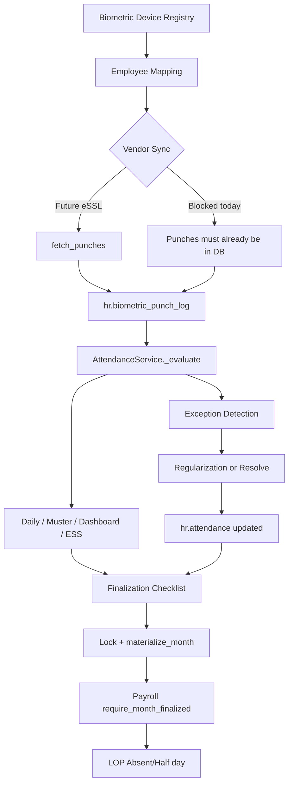

# Trishul HRMS — Attendance Module  
## Functional & Business Logic Documentation

| Attribute | Value |
|---|---|
| Document version | 1.0 |
| Module | HR → Attendance & Biometric |
| Policy reference | `HR POLICY-TTPL UPDATED (2).doc` (TTPL HR & Development Policy) |
| Source of truth order | (1) Trishul source code (2) Database schema / configured rules (3) TTPL HR Policy (4) Approved configurations |
| Scope | Documentation only — no code, config, or data changes |
| Audience | HR, Management, Project Managers, Developers, QA |

**Legend used throughout**

| Label | Meaning |
|---|---|
| Policy-defined rule | Explicitly stated in TTPL HR Policy |
| System-configured rule | Stored in UI/settings and consumed by calculation |
| Hardcoded system rule | Implemented in code without a matching policy clause |
| Derived/calculated rule | Computed from punches / shifts / leave / holidays |
| Recommendation | Suggested improvement — not current behaviour |
| Missing business decision | Policy incomplete or ambiguous; not invented in code |
| **Not defined in the provided HR Policy.** | No matching policy text found |
| **System implementation rule — not explicitly defined in the HR Policy.** | Exists in code only |

---

## 1. Executive Summary

Trishul Attendance is a **live calculation** module. Daily statuses are computed from biometric punches, approved leave, holidays, and shift/org rules. Corrections go through **Exceptions** and **Regularization**. **Finalization** writes days into `hr.attendance` and locks the month. **Payroll** refuses to run until the month is finalized and then applies LOP from persisted **Absent** (1 day) and **Half day** (0.5 day).

TTPL policy requires biometric attendance, 09:30–17:30 office timing, 15-minute grace, and half-day salary impact when grace is crossed. The system applies late-beyond-grace as **Half day** on persist. Unresolved **Missing Punch** is **not** auto-converted to Absent/LOP (policy treats non-punching as misconduct for review). **Overtime pay** is not defined in the policy and is not calculated in payroll. **eSSL vendor sync** is API/UI-ready but **blocked** until official contract documentation exists.

---

## 2. Attendance Module Overview

### 2.1 Business purpose

Record who worked which day, detect anomalies, allow authorized corrections, close the month, and feed Loss of Pay into payroll — aligned with GreytHR-style HRMS flows and TTPL policy.

### 2.2 Module boundaries

| In Attendance | Outside Attendance (related) |
|---|---|
| Daily / muster / exceptions / regularization | Leave request & Comp-Off balances (Leave module) |
| Shifts, assignments, org attendance rules | Holiday **master** CRUD (Leave/Holiday screens; Attendance Rules shows read-only list) |
| Finalization & month lock | Payroll run calculation (consumes finalized attendance) |
| Biometric devices, mapping, punches, sync shell | — |

### 2.3 High-level architecture

```
Biometric punches (hr.biometric_punch_log)
        + Leave (approved) + Holidays + Shifts/Rules
        ↓
AttendanceService._evaluate (live)
        ↓
Screens: Daily / Muster / Exceptions / Dashboard / ESS
        ↓
Regularization / Exception Resolve → hr.attendance
        ↓
Finalization lock → materialize month → core.system_setting
        ↓
Payroll require_month_finalized → lop_days(Absent, Half day)
```

---

## 3. Screen Inventory

| # | Screen | Route | Implemented? | Functional status |
|---|---|---|---|---|
| 1 | Attendance Dashboard | `/hr/attendance/dashboard` | Yes | WORKING |
| 2 | My Attendance (ESS) | `/hr/attendance/mine` | Yes | WORKING |
| 3 | Daily Attendance | `/hr/attendance/daily` | Yes | WORKING |
| 4 | Monthly Muster | `/hr/attendance/monthly-muster` | Yes | WORKING |
| 5 | Attendance Exceptions | `/hr/attendance/exceptions` | Yes | WORKING |
| 6 | Attendance Regularization | `/hr/attendance/regularization` | Yes | WORKING |
| 7 | Shift & Attendance Rules | `/hr/attendance/rules` | Yes | PARTIALLY WORKING (some rules stored unused; holidays read-only) |
| 8 | Holiday & Weekly Off | Part of Rules + Leave Holiday master | Partial | PARTIALLY WORKING |
| 9 | Attendance Finalization | `/hr/attendance/finalization` | Yes | WORKING |
| 10 | Attendance Reports | `/hr/attendance/reports` | Yes | WORKING |
| 11 | Biometric Dashboard | `/hr/biometric/dashboard` | Yes | PARTIALLY WORKING (integration blocked) |
| 12 | Biometric Devices | `/hr/biometric/devices` | Yes | WORKING (registry) |
| 13 | Employee–Biometric Mapping | `/hr/biometric/mapping` | Yes | PARTIALLY WORKING (bulk upload stub) |
| 14 | Biometric Punches | `/hr/biometric/punches` | Yes | WORKING (read) |
| 15 | Biometric Sync History | `/hr/biometric/sync-history` | Yes | PARTIALLY WORKING (sync blocked) |
| 16 | Out Duty / Field Attendance | — | No | NOT IMPLEMENTED |

**Screens documented in detail:** 15 implemented surfaces (9 attendance + 5 biometric + holidays-as-tab).  
**Not implemented:** Out Duty / Field Attendance as a product feature.

---

## 4. Detailed Screen Functional Documentation

### 4.1 Attendance Dashboard

#### A. Overview
| Item | Detail |
|---|---|
| Route | `/hr/attendance/dashboard` |
| Purpose | One-day attendance overview for HR |
| Users | HR / Admin / Manager with employee view |
| Permissions (route) | `core.employee.view` or `core.employee.manage` |
| API | `GET /hr/attendance/dashboard` |
| Status | **WORKING** |

#### B. Layout
KPI cards, overview slices, trend, department table, exception list, quick actions, finalized-month indicator, date navigation.

#### C. Key fields
| Field | Description | Data source | Business meaning | Calculation |
|---|---|---|---|---|
| Present-like | Present + Late + Missing Punch | Live evaluate | People who appeared / punched | Sum of statuses |
| Absent | No punches on working day | Live evaluate | Not present | Status = Absent |
| Missing Punch | Incomplete punch pair | Live evaluate | Needs review | IN without OUT |
| Is month finalized | Lock flag | `hr.attendance.finalization.YYYY-MM` | Payroll readiness | Setting exists |

#### D. Actions
| Action | User | Rule | Result |
|---|---|---|---|
| Change date | Viewer | Any past/today | Reloads dashboard |
| Navigate to exceptions / reports | Viewer | Links | Opens target screen |

#### E–G
Read-only. No write actions. Status: **WORKING**.

---

### 4.2 Daily Attendance

#### A. Overview
| Item | Detail |
|---|---|
| Route | `/hr/attendance/daily` |
| Purpose | Employee attendance for one calendar date |
| Users | HR / Admin |
| Permissions | Employee view (create reg for others needs manage on API) |
| API | `GET /hr/attendance/daily`, `POST /hr/attendance/regularizations` |
| Status | **WORKING** |

#### B. Layout
Date picker, search/filters, tabs (records / exceptions-like / regularization), table, drawer (punches), Regularize dialog, CSV export.

#### C. Fields
| Field | Description | Source | Meaning |
|---|---|---|---|
| Status | Present / Late / Missing Punch / Absent / On Leave / Off Day / Holiday | Live `_evaluate` | Day outcome |
| First In / Last Out | Punch times | Biometric punch log | Arrival / departure |
| Working hours | Paired IN–OUT minutes | `_worked_minutes` | Time on site |
| Shift | Assigned / default General | `hr.employee_shift` / default | Expected window |

#### D. Actions
| Action | User | Validation | Result |
|---|---|---|---|
| Filter / export | Viewer | — | Client/CSV |
| Regularize | Manage (API) | Reason; month not locked | Creates Pending request |
| Open drawer | Viewer | — | Shows punches from daily payload |

#### G. Status
**WORKING**. Notes: WFH KPI forced to 0 in UI; attachment is filename only (no upload API); `employeeHistory` API unused by UI.

---

### 4.3 Monthly Muster

#### A. Overview
| Item | Detail |
|---|---|
| Route | `/hr/attendance/monthly-muster` (`/muster` redirects) |
| Purpose | Month matrix of day codes per employee |
| API | `GET /hr/attendance/muster` |
| Status | **WORKING** |

#### Codes (system)
| Code | Meaning |
|---|---|
| P | Present (also used for Missing Punch on muster) |
| L | Late |
| A | Absent |
| PL | On Leave |
| OFF | Weekly off |
| H | Holiday |
| WFH | Defined in schema — **not emitted** by evaluator |

#### G. Status
**WORKING**. Finalization “view details” may pass query params that muster does not consume.

---

### 4.4 Attendance Exceptions

#### A. Overview
| Item | Detail |
|---|---|
| Route | `/hr/attendance/exceptions` |
| Purpose | Review anomalies and resolve or regularize |
| APIs | `GET /exceptions`, `POST .../resolve` (manage), `POST /regularizations` (manage) |
| Status | **WORKING** |

#### Exception types (system)
Missing Punch, Late Arrival, Early Exit, Short Hours, Absent.

#### Resolve behaviour
| Type | Default / requirement |
|---|---|
| Missing Punch / Absent | **Must** choose Present / Half day / Absent / On duty |
| Late Arrival | Defaults to **Half day** (policy: grace crossed → half-day deduction); HR may override |
| Early Exit / Short Hours | Default Present |

Month lock blocks resolve. Audit written to `core.audit_log`.

---

### 4.5 Attendance Regularization

#### A. Overview
| Item | Detail |
|---|---|
| Route | `/hr/attendance/regularization` |
| Purpose | Correction requests and approvals |
| Create API | `POST /regularizations` — **manage** |
| Decide APIs | approve / reject — **manage** |
| Status | **WORKING** |

#### Lifecycle
**Request (Pending) → Approve / Reject → Attendance update (approve only) → Audit**

No separate Draft stage in code.

#### On approve
Applies requested IN/OUT, recalculates worked hours, sets requested status (may apply half-day threshold), sets `is_regularized=true`, `source=Manual`. **Does not delete original biometric punches.**

#### On reject
Rejection remark required; attendance unchanged.

---

### 4.6 Shift & Attendance Rules

#### A. Overview
| Item | Detail |
|---|---|
| Route | `/hr/attendance/rules` |
| Tabs | Shifts / Attendance Rules / Shift Assignment / Holidays |
| Status | **PARTIALLY WORKING** |

#### Holidays tab
Read-only list for leave year (`GET /hr/attendance/holidays`). Holiday **CRUD** is not on this screen.

#### Org rules fields
| Field | Consumed by engine? |
|---|---|
| lateArrivalGraceMinutes | Yes |
| earlyExitGraceMinutes | Yes |
| weeklyOffDays | Yes (fallback) |
| standardWorkHours | Yes (half-day fallback) |
| workingDaysPerWeek | No (validation/UI) |
| otAfterHours / otApprovalRequired | No |
| weeklyOffAppliesTo | No |
| autoAttendanceEnabled / manualAttendanceEnabled | No |

---

### 4.7 My Attendance (ESS)

| Item | Detail |
|---|---|
| Route | `/hr/attendance/mine` |
| Purpose | Employee views own month; requests own regularization |
| Create | `POST /mine/regularizations` — forces `actor.employee_id` |
| Status | **WORKING** |

Blocked when month finalized (`canRegularize=false`).

---

### 4.8 Attendance Finalization

| Item | Detail |
|---|---|
| Route | `/hr/attendance/finalization` |
| Lock API | `POST /finalization/lock` — manage |
| Status | **WORKING** |

Checklist: processed muster, no pending exceptions, no pending regularizations, all groups Ready, no Pending groups.  
On lock: `materialize_month` → write `hr.attendance` → save `hr.attendance.finalization.YYYY-MM`.

---

### 4.9 Attendance Reports

| Item | Detail |
|---|---|
| Route | `/hr/attendance/reports` |
| APIs | `reports/summary`, muster, exceptions for CSV |
| Status | **WORKING** (operational export, not full BI) |

---

### 4.10 Biometric screens

| Screen | Route | Status |
|---|---|---|
| Biometric Dashboard | `/hr/biometric/dashboard` | PARTIALLY WORKING — shows integration Disabled/Blocked |
| Devices | `/hr/biometric/devices` | WORKING — registry CRUD |
| Mapping | `/hr/biometric/mapping` | PARTIALLY WORKING — bulk upload stub |
| Punches | `/hr/biometric/punches` | WORKING — read stored punches |
| Sync History | `/hr/biometric/sync-history` | PARTIALLY WORKING — Sync Now fails honestly until eSSL contract |

Permissions: route/nav use `hr.biometric.view` / `manage`; sync needs `hr.biometric.sync` or manage.

---

### 4.11 Out Duty / Field Attendance

**NOT IMPLEMENTED** as a screen or dedicated API.  
Schema has `On duty` status and geo columns on `hr.attendance`; WFH Correction regularization maps to On duty. Policy office-work outing uses register/HR App — **Not fully modelled as Out-Duty product in Attendance.**

---

## 5. Attendance Business Logic

### 5.1 Daily Attendance Calculation

**Engine:** `AttendanceService` in `backend/src/trishul_api/modules/hr/attendance/service.py`.

#### Punch retrieval
1. Day bounds from repository.
2. Load `hr.biometric_punch_log` where `employee_id` is not null, `is_active`, **`source != 'Demo'`**, within day.
3. Unmapped punches (`employee_id` null) are **ignored** by attendance.

#### IN / OUT identification
- Punch type `IN` / `OUT` (case-insensitive).
- First IN = first IN punch (or first punch if untyped).
- Last OUT = last OUT punch.

#### Multiple punches — worked minutes (actual formula)

**System implementation rule — not explicitly defined in the HR Policy.**

```
Sort punches by punched_at
Pair each open IN with next OUT:
  worked_minutes += max(0, minutes(OUT − IN))
If still 0 and ≥ 2 punches:
  worked_minutes = max(0, minutes(last − first))
Display: "Xh YYm"
```

**Break duration is not subtracted** in code. Policy lists lunch 1:30–2:00 PM but engine does not deduct break minutes.

#### Late calculation

```
grace_deadline = shift_start + lateArrivalGraceMinutes  (org rule; default 15)
if first_in > grace_deadline → Late
late_by = minutes(first_in − grace_deadline)
```

#### Early exit (exception only)

```
early_cutoff = shift_end − earlyExitGraceMinutes
if last_out < early_cutoff → Early Exit exception
```

#### Missing punch
IN present, no distinct OUT → status **Missing Punch**.

#### Incomplete / invalid / duplicate
- Incomplete pair → Missing Punch (display); not persisted as Absent.
- Invalid/untyped punches still contribute via first/last fallback.
- Duplicate punches at sync: tracked as `records_duplicate` when sync works; attendance pairs by time order.
- Demo source excluded from calculation.

#### Materialization
| Path | When |
|---|---|
| Live screens | Compute only — no write |
| Exception resolve / Regularization approve | Write `hr.attendance` |
| Finalization lock | `materialize_month` for days ≤ today; skips Missing Punch (`_persist_status` → None) |

---

## 6. Attendance Status Rules

| Attendance Status | Trigger / condition | Business meaning | Payroll impact | Exception / action |
|---|---|---|---|---|
| Present | Complete punches, not late | Worked day | None (unless short hours → Half day on persist) | — |
| Late | First IN after grace | Late arrival | Persist as **Half day** (0.5 LOP) | Late Arrival exception |
| Missing Punch | IN without OUT | Incomplete record | **None until resolved** (not auto Absent) | Must resolve / regularize |
| Absent | Working day, no punches, no leave/off/holiday | Not present | 1.0 LOP when persisted | Absent exception |
| Half day | Persist of Late; short hours ≤ threshold; half-day leave; resolve/approve | Partial pay day | 0.5 LOP | Short Hours / Late |
| On Leave | Approved leave | Leave cover | Not LOP via attendance status Leave | — |
| Off Day / Week off | Weekly off weekday | Off | None | — |
| Holiday | Matching holiday | Holiday | None | — |
| On duty | Resolve status / WFH Correction approve | Duty / WFH correction | No LOP for On duty | Manual |
| Regularized | `is_regularized=true` | Corrected day | Per final status | Cleared from pending exceptions |
| Pending / Approved / Rejected | Regularization request statuses | Workflow | Indirect | — |

**Automatic vs manual**
- Present/Late/Absent/Missing Punch/Off/Holiday/Leave: **automatically calculated** (live).
- Half day on persist: **derived** from Late / hours / leave.
- On duty / explicit resolve statuses: **manual** via resolve or regularization.
- After finalization: statuses **locked** from mutation APIs.

---

## 7. Late & Grace Logic

### Policy (TTPL)
- Office: **09:30 AM – 05:30 PM**, break 1:30–2:00 PM.  
- Grace **15 minutes**; **3 days/month** without deduction for morning/lunch.  
- If grace **crossed** → **half-day salary deduction**.

### System
| Aspect | Implementation |
|---|---|
| Grace minutes | Org `lateArrivalGraceMinutes` (default 15) overrides shift grace for evaluation |
| Late display | Status Late |
| Persist | Late → **Half day** |
| Payroll | Half day = 0.5 LOP after materialize/finalize |
| 3 free grace days/month | **Not implemented** |
| Lunch-hour grace | **Not implemented** as separate punch window |

**Missing business decision:** Exact treatment of the 4th within-grace late day in a month.

**Classification:** Grace minutes = Policy-defined + System-configured. Late→Half day persist = Policy-defined. Three grace days = Policy-defined but **Missing business decision / NOT IMPLEMENTED** in engine.

---

## 8. Missing Punch Logic

| Case | Behaviour |
|---|---|
| Missing OUT (IN only) | Display Missing Punch; exception raised |
| No punches on working day | Absent (not Missing Punch) |
| Persist | `_persist_status` returns **None** — **no hr.attendance row** for silent LOP |
| Auto Absent / auto LOP | **No** |
| Employee regularization | Yes (ESS or HR) |
| Resolve | HR manage; must choose Present / Half day / Absent / On duty |
| Audit | Yes on resolve/regularization |
| Policy | Non-punching is **misconduct** for review — not silent LOP |

**Policy-defined:** biometric required; not punching is misconduct.  
**System implementation rule — not explicitly defined in the HR Policy:** keep Missing Punch unresolved until HR acts (GreytHR-style exception queue).

---

## 9. Regularization Workflow

```
Employee (ESS) or HR (manage)
        ↓
Pending request (hr.attendance_regularization)
        ↓
HR Approve (manage)  →  update hr.attendance + is_regularized + audit
   or
HR Reject (manage)   →  request Rejected; attendance unchanged + audit
```

| Topic | Rule |
|---|---|
| Who creates (self) | Any user with employee view via `/mine/regularizations` |
| Who creates (others) | `core.employee.manage` only |
| Duplicate | One Pending per employee per date |
| Month lock | Blocked by `require_day_writable` |
| Original IN/OUT | From linked attendance / punches |
| Requested IN/OUT | Packed into `reason` field |
| Attachment | Filename text only — **no file storage API** |
| Approve | Applies times/status; punches preserved |
| Reject | Remark mandatory |

---

## 10. Shift Logic

| Element | Source | Role |
|---|---|---|
| Shift master | `hr.shift` | start, end, grace, half_day_hours |
| Assignment | `hr.employee_shift` | employee, shift, from/to, weekly_off_days |
| Default if none | Hardcoded General 09:00–18:00, grace 10, weekly SUN | Fallback |
| Org override | Rules JSON | Late grace, weekly off fallback, half-day from standardWorkHours/2 |

**Policy office timing 09:30–17:30** should be configured on shifts; default General 09:00–18:00 is a **system fallback**, not the policy table.

---

## 11. Weekly Off Logic

**Priority (actual):**
1. `employee_shift.weekly_off_days` for the day  
2. Else org `weeklyOffDays` (default `["SUN"]`)  
3. Else Sunday

| Config | Used? |
|---|---|
| weeklyOffDays | Yes |
| weeklyOffAppliesTo | **Stored, unused by engine** |
| workingDaysPerWeek | UI/validation only |

**Policy:** Sunday referenced in CL rules; Comp-off for weekly offs.  
**Saturday as org off:** **Not defined in the provided HR Policy** as mandatory HO weekly off — configurable.

Working on weekly off → punch status shown with remark; Comp-off eligibility is **Leave policy**, not auto-created by Attendance.

---

## 12. Holiday Logic

| Topic | Behaviour |
|---|---|
| Master | `hr.holiday` |
| Leave year | From leave policy year basis (financial/calendar) |
| Applicability | Branch / state via repository `holiday_applies` |
| No punches | Status Holiday |
| With punches | Punch status + holiday remark |
| Attendance Rules UI | Read-only holiday list |
| Policy | National/festival list finalized at FY start |

---

## 13. Comp-Off Logic

**Policy-defined (TTPL Leave section):**
- Eligible for authorized work on weekly off / holiday / declared non-working day  
- HOD/Reporting Manager authorization & certification  
- Pre-approval required to be eligible  
- Avail within **90 days** or lapse  
- Minimum one day presence on that off/holiday  

**Attendance module:** Does **not** create Comp-Off.  
**Leave module:** Comp-Off balances / basis (`COMPANY_COMP_OFF`, etc.) via leave APIs.

| Policy rule | In Attendance? |
|---|---|
| Auto Comp-Off from muster work-on-off | NOT IMPLEMENTED |
| 90-day expiry | Leave domain (verify leave config) — not Attendance |

---

## 14. Out-Duty / Field Attendance

**NOT IMPLEMENTED** as Attendance product.  
Policy: office work outside → register / HR App.  
System: may use Regularization / On duty status as workaround — not a full Out-Duty workflow.

---

## 15. Attendance Finalization & Lock

### Checklist
1. Attendance processed for employees  
2. Exceptions reviewed (no pending)  
3. Regularization requests approved (no pending)  
4. All groups Ready  
5. No Pending groups  

### On finalize
1. `materialize_month` → upsert non-regularized days into `hr.attendance` (skips Missing Punch)  
2. Write lock `core.system_setting` key `hr.attendance.finalization.YYYY-MM`  

### What lock protects
Regularization create / approve / reject; exception resolve; other attendance mutations for dates in that month (`require_day_writable`).

### Unlock / reopen
**Not implemented** as a product action in current APIs.

### Payroll dependency
`require_month_finalized` before payroll process/recalculate.

---

## 16. Exception Catalogue

| Exception | Business meaning | Trigger | System behaviour | Responsible | Resolution | Attendance impact | Payroll impact |
|---|---|---|---|---|---|---|---|
| Missing Punch | Incomplete biometric pair | IN without OUT | Exception Pending; no silent LOP row | HR + Employee | Resolve status or Regularize | After resolve/approve | Per final status |
| Late Arrival | Beyond grace | first_in > grace_deadline | Exception; persist Late→Half day | HR | Resolve (default Half day) / Regularize | Half day unless overridden | 0.5 if Half day |
| Early Exit | Left before end−grace | last_out < early_cutoff | Exception only | HR | Resolve→Present default / Regularize | Per resolution | If Half day/Absent |
| Short Hours | Worked below threshold | hours ≤ half-day or short band | Exception | HR | Resolve / Regularize | May Half day on persist | 0.5 if Half day |
| Absent | No presence | No punches on working day | Exception; persist Absent | HR | Resolve requires status / Regularize | Absent unless changed | 1.0 if Absent |
| Unmapped biometric user | Punch without employee | mapping missing | Punch stored without employee_id; **ignored** by attendance | HR Biometric | Map employee | Until mapped, looks Absent | Risk of false LOP |
| No punch data | Device/sync empty | Sync blocked / no logs | Many Absents / Missing | HR / IT | Feed punches | High | High if finalized wrongly |
| Failed / Skipped sync | Vendor sync unavailable | sync_enabled false or contract missing | Log Skipped/Failed; API error; **not Success** | IT | Provide eSSL docs | None invented | — |
| Device offline | Heuristic status | Dashboard label | Informational | IT | Fix device | — | — |
| Regularization Pending | Awaiting approval | Create request | Blocks finalization checklist | Approver | Approve/Reject | None until approve | — |
| Regularization Rejected | Denied | Reject with remark | Attendance unchanged | Employee | New request if allowed | None | — |
| Month Locked | Finalized | Setting lock | Mutations ApiError | — | No unlock API | Frozen | Payroll may run |
| Unauthorized access | Permission denied | Missing manage/view/sync | HTTP 403 | Admin | Grant role | — | — |
| Duplicate Pending regularization | Second pending same day | Create | ApiError | User | Wait or cancel process | — | — |
| Invalid date/time on approve | Bad requested times | Parse fail | Times may not apply | HR | Correct request | Partial | — |
| Demo punches | Sample data | source=Demo | **Excluded** from attendance calc | — | — | None | None |
| Weekly Off / Holiday attendance | Worked on off/holiday | Punches on off day | Present-like + remark | Leave/HR | Comp-off via Leave if eligible | Displayed | Not auto Comp-off |
| Overtime | Extra hours pay | — | **Not calculated** | — | — | — | None |
| Attendance calculation failure | Service/DB error | Runtime | API error | IT | Fix infra | — | — |

---

## 17. Business Rules Master

| Rule ID | Business Rule | Policy Reference | Implementation | Actual Logic | Impact | Status |
|---|---|---|---|---|---|---|
| ATT-01 | Office 09:30–17:30 | Working Hours | Shift master (configurable) | Shift start/end used | Expected hours | COMPLIANT if shifts configured |
| ATT-02 | Biometric mandatory | Attendance Process | Punch log + evaluate | Attendance from punches | Source of truth | PARTIALLY (sync blocked) |
| ATT-03 | 15 min grace | Punctuality | `lateArrivalGraceMinutes` | Deadline = start+grace | Late vs Present | COMPLIANT |
| ATT-04 | Cross grace → half day pay | Punctuality | `_PERSIST_STATUS` Late→Half day | LOP 0.5 | Salary | COMPLIANT |
| ATT-05 | 3 grace days/month free | Punctuality | — | Not coded | — | NOT IMPLEMENTED |
| ATT-06 | Lunch break 1:30–2:00 | Shift table | — | Break not deducted | Hours | PARTIALLY COMPLIANT |
| ATT-07 | Mark from system only | Process clause 4 | Live evaluate | No free manual status edit API | Integrity | COMPLIANT |
| ATT-08 | Not punching = misconduct | Misconduct (h) | Missing Punch exception | No auto LOP | Review queue | COMPLIANT |
| ATT-09 | Missing Punch ≠ silent Absent | Derived from ATT-08 | `_persist_status` None | Blocks silent LOP | Finalize needs resolve | System rule (policy-aligned) |
| ATT-10 | Weekly off | Leave/Comp-off | Assignment + org SUN | Off Day status | No LOP | COMPLIANT (configurable) |
| ATT-11 | Holidays | Holiday clause | `hr.holiday` | Holiday status | No LOP | COMPLIANT (read path) |
| ATT-12 | Comp-off 90 days | Leave §8–11 | Leave module | Not Attendance | Leave | OUT OF ATTENDANCE SCOPE |
| ATT-13 | Regularization approval | Not named; GreytHR-style | Reg workflow | Manage approve | Corrections | System rule |
| ATT-14 | Month lock before payroll | System | Finalization + payroll gate | require_month_finalized | Payroll | System rule |
| ATT-15 | LOP Absent=1 Half=0.5 | Derived | `lop_days` | Payslip lop_days | Pay | System rule |
| ATT-16 | OT pay | **Not defined in policy** | Rules fields only | Unused | None | POLICY NOT DEFINED |
| ATT-17 | ESS own requests only | Security | mine + manage create | Auth binding | Access | System rule |
| ATT-18 | Demo punches excluded | Data integrity | `source != Demo` | No fake attendance | Quality | System rule |

---

## 18. HR Policy Mapping

| Policy Clause | Requirement | System Logic | Screen | Compliance | Gap |
|---|---|---|---|---|---|
| Shift 09:30–17:30 | Standard HO/Branch hours | Configurable shift | Rules → Shifts | COMPLIANT* | Must configure shifts to match |
| Biometric punch in/out | Compulsory | Punch log + evaluate | Biometric + Daily | PARTIALLY COMPLIANT | Vendor sync BLOCKED |
| Grace 15 min | Allowed | Org/shift grace | Rules | COMPLIANT | — |
| 3 days/month free grace | No deduction | Not implemented | — | NOT IMPLEMENTED | Pending decision |
| Grace crossed → half day | Salary deduction | Late→Half day + LOP 0.5 | Exceptions / Finalize / Payroll | COMPLIANT | — |
| Attendance from system only | No informal mark | Live calc + authorized correction | Daily / Reg | COMPLIANT | — |
| Not punching misconduct | Discipline | Missing Punch queue | Exceptions | COMPLIANT | — |
| Office outing register/HR App | Out duty logging | No Out-Duty module | — | NOT IMPLEMENTED | Use workaround or build later |
| Comp-off on weekly off/holiday | Authorized + 90 days | Leave module | Leave ESS | PARTIALLY (Leave) | Not Attendance auto |
| Sunday in CL | Weekly off reference | Default weeklyOffDays SUN | Rules | COMPLIANT | Saturday TBD |
| Overtime pay | — | — | — | NOT DEFINED IN POLICY | Keep out of Phase 1 payroll |

\*Compliance assumes production shift master matches policy timings.

---

## 19. Biometric / eSSL Integration

| Stage | UI | API | Working? |
|---|---|---|---|
| Device registration | Yes | Yes | Yes |
| Employee mapping | Yes | Yes | Yes (bulk upload stub) |
| View punches | Yes | Yes | Yes (DB contents) |
| Sync Now | Yes | Yes | **BLOCKED** — eSSL contract missing; sync_enabled typically false |
| Sync history | Yes | Yes | Yes (logs Skipped/Failed honestly) |
| Integration banner | Yes | `integrationStatus` | Disabled or Blocked — never false Ready |

**Production readiness:** Device/mapping/punch viewing ready. **Automatic punch import from eSSL not production-ready** until official API documentation and credentials exist.

---

## 20. Permissions Matrix

| Function | Employee (linked) | Manager (view) | HR/Admin (manage) | Backend validation |
|---|---|---|---|---|
| View own attendance (ESS) | Yes | Yes | Yes | `/mine` uses actor.employee_id |
| View all daily/muster | If has employee.view | Yes | Yes | CAN_VIEW |
| Create own regularization | Yes (mine API) | Yes (mine) | Yes | force employee_id |
| Create for others | No | No* | Yes | CAN_MANAGE + service check |
| Approve / Reject | No | No* | Yes | CAN_MANAGE |
| Resolve exceptions | No | No* | Yes | CAN_MANAGE |
| Manage shifts/rules/assignments | No | No* | Yes | CAN_MANAGE |
| Finalize / lock | No | No* | Yes | CAN_MANAGE |
| View biometric | Needs biometric.view | — | biometric.manage | Separate permission family |
| Biometric sync | Needs sync or manage | — | Yes | CAN_SYNC |
| Holidays CRUD | Leave permissions | — | — | Not on Attendance Rules write |

\*Unless also granted `core.employee.manage`.

**Frontend vs backend:** Route guards use view permissions for most Attendance screens; destructive actions rely on API 403. Biometric nav aligned to `hr.biometric.*`.

---

## 21. Screen / API / Database Mapping

| Screen | Component | API | Router | Service | Main tables |
|---|---|---|---|---|---|
| Dashboard | attendance-dashboard.page.ts | GET /dashboard | attendance/router | AttendanceService.dashboard | punches, leave, holiday, shift, setting |
| Daily | attendance-daily.page.ts | GET /daily | same | list_daily | same |
| Muster | attendance-muster.page.ts | GET /muster | same | list_muster | same |
| Exceptions | attendance-exceptions.page.ts | GET /exceptions; POST resolve | same | list_exceptions / resolve_exception | + hr.attendance |
| Regularization | attendance-regularization.page.ts | /regularizations* | same | create / decide | attendance_regularization, attendance, audit_log |
| ESS Mine | attendance-mine.page.ts | /mine; POST mine/regularizations | same | mine / create_mine | same |
| Rules | attendance-rules.page.ts | /shifts, /rules, /shift-assignments, /holidays | rules_ops | ShiftRulesService | shift, employee_shift, system_setting, holiday |
| Finalization | attendance-finalization.page.ts | /finalization; POST lock | finalization_ops | FinalizationService | system_setting, attendance |
| Reports | attendance-reports.page.ts | /reports/summary + muster/exceptions | service | reports_summary | same |
| Bio Dashboard | biometric-dashboard.page.ts | GET /hr/biometric/dashboard | biometric/router | BiometricService | device, mapping, punch, sync_log |
| Devices | biometric-devices.page.ts | /devices | same | CRUD | biometric_device |
| Mapping | biometric-mapping.page.ts | /mappings | same | CRUD | biometric_employee_mapping |
| Punches | biometric-punches.page.ts | /punches | same | list | biometric_punch_log |
| Sync | biometric-sync.page.ts | /sync, /sync-logs | same | run_manual_sync | sync_log, punch_log |

---

## 22. End-to-End Attendance Workflow



| Stage | Input | Logic | Output | Exceptions |
|---|---|---|---|---|
| Device | Admin data | CRUD | Device row | Duplicate code |
| Mapping | Employee + bio user id | Active mapping | Mapped punches | Unmapped ignored |
| Sync | Device + secrets | Contract required | Punches / Skipped | BLOCKED |
| Evaluate | Punches+leave+holiday+shift | `_evaluate` | Display status | Missing/Late/etc. |
| Correct | Request / resolve | Manage + lock check | Persisted status | Unauthorized / locked |
| Finalize | Checklist | Materialize + lock | Month closed | Pending items |
| Payroll | Lock + attendance | lop_days | Payslip LOP | Not finalized |

---

## 23. Functional Testing Checklist

| Test ID | Screen | Scenario | Expected | Implementation | Test Status | Risk |
|---|---|---|---|---|---|---|
| T01 | Daily | Normal IN+OUT on time | Present | Yes | Not executed | Low |
| T02 | Daily | Late > grace | Late display; Half day on persist | Yes | Not executed | Medium |
| T03 | Daily | Within grace | Present | Yes | Not executed | Low |
| T04 | — | 3rd vs 4th grace day | Policy free days | Not implemented | N/A | Medium |
| T05 | Exceptions | Missing OUT | Missing Punch pending | Yes | Not executed | High if ignored |
| T06 | Exceptions | Resolve MP without status | Error | Yes | Not executed | Low |
| T07 | Exceptions | Resolve Late default | Half day | Yes | Not executed | Medium |
| T08 | Daily | No punches working day | Absent | Yes | Not executed | High |
| T09 | Engine | Duplicate close punches | Paired minutes | Yes | Not executed | Low |
| T10 | Engine | Demo source punches | Ignored | Yes | Not executed | Low |
| T11 | Muster | Weekly off | OFF | Yes | Not executed | Low |
| T12 | Muster | Holiday | H | Yes | Not executed | Low |
| T13 | ESS | Own regularization | Pending created | Yes | Not executed | Low |
| T14 | Reg | Other employee without manage | 403 | Yes | Not executed | Security |
| T15 | Reg | Approve times | Attendance updated | Yes | Not executed | High |
| T16 | Reg | Reject | Attendance unchanged | Yes | Not executed | Medium |
| T17 | Reg | Unauthorized approve | 403 | Yes | Not executed | Security |
| T18 | Finalization | Pending exceptions | Cannot lock | Yes | Not executed | High |
| T19 | Finalization | Lock then regularize | Error locked | Yes | Not executed | High |
| T20 | Biometric | Sync Now | Error / Skipped not Success | Yes | Not executed | High ops |
| T21 | Mapping | Unmapped punches | Not in attendance | Yes | Not executed | High |
| T22 | Payroll | Run without finalize | Error | Yes | Not executed | Critical |
| T23 | Payroll | Absent/Half day LOP | 1 / 0.5 | Yes | Not executed | Critical |

*Test Status = Not executed — documentation task only; no tests were run against production data.*

---

## 24. Known Gaps & Limitations

1. eSSL punch sync **BLOCKED**  
2. Three monthly free grace days **not implemented**  
3. Lunch break not deducted from worked hours  
4. `weeklyOffAppliesTo`, OT fields, auto/manual flags **stored unused**  
5. Out-Duty / Field Attendance **not implemented**  
6. Comp-Off not auto-generated from Attendance  
7. Regularization attachment filename only  
8. Biometric bulk upload stub  
9. No month unlock API  
10. Default General shift 09:00–18:00 ≠ policy 09:30–17:30 until configured  
11. Muster treats Missing Punch as **P** (display convention)  
12. WFH muster code unused  

---

## 25. Go-Live Readiness

| Area | Readiness |
|---|---|
| Attendance viewing & correction workflows | Ready if punches exist |
| Policy late→half day | Ready |
| Finalization → Payroll LOP | Ready |
| ESS regularization | Ready |
| Biometric registry/mapping | Ready |
| Automatic device sync | **Not ready** |
| Full grace-day monthly quota | **Not ready** |
| Out-duty product | **Not ready** |

**Overall:** Ready for controlled go-live **with a confirmed punch data source** and HR operating exception/regularization queues. Not ready for unattended biometric sync.

---

## 26. Pending Business Decisions

1. How are punches loaded until eSSL sync works?  
2. Exact rule after 3 within-grace late days in a month?  
3. Is Saturday an org weekly off for HO/Branches?  
4. Should `weeklyOffAppliesTo` be enforced?  
5. Is OT pay ever in Phase 1? (**Not defined in policy** — recommend No.)  
6. Out-Duty product scope vs register/HR App?  
7. Who (roles) gets `core.employee.manage` vs managers?  

---

## 27. Recommended Next Steps

1. Confirm punch ingestion plan for UAT/production.  
2. Align shift masters to 09:30–17:30.  
3. Obtain eSSL API documentation before enabling sync.  
4. Decide 3-grace-days algorithm, then implement if approved.  
5. Execute the functional test checklist in a non-production environment.  
6. Keep OT out of payroll until policy defines rates/earnings.  
7. Optionally build Out-Duty if policy register/HR App must be digitized.

---

## Appendix A — Counts (this document)

| Item | Count |
|---|---|
| Screens / surfaces documented | 15 implemented + 1 not implemented (Out-Duty) |
| Business rules in master table (ATT-xx) | 18 |
| Exceptions in catalogue | 20+ |
| Policy mapping rows | 12 |

## Appendix B — Confirmation

This document was produced from **read-only inspection** of Trishul source code, schemas, and the TTPL HR Policy extract.

**No source code, database schema, database data, attendance records, configurations, biometric sync, finalization, approvals, or payroll data were modified while producing this documentation.**
